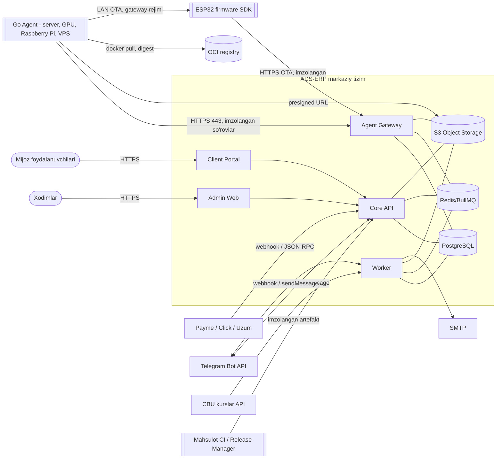
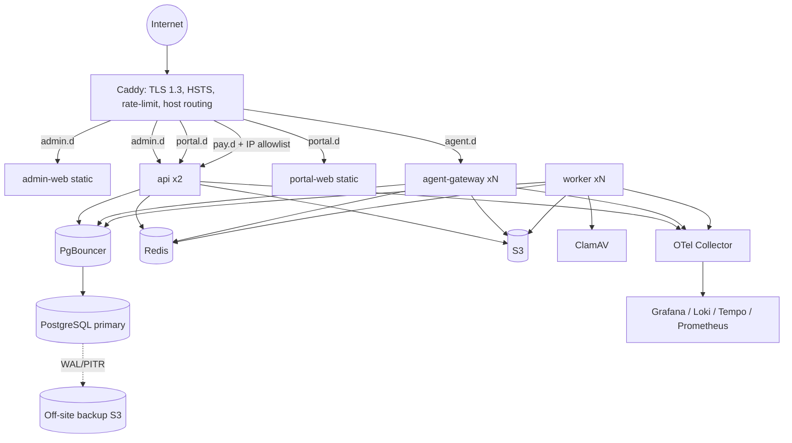

# Tizim arxitekturasi

> ADS-ERP arxitektura hujjatlari · tasdiqlangan reja (2026-11-10) asosida · [Hujjatlar indeksi](../README.md)

## 3. Tizim arxitekturasi

### 3.1 System Context (C4 L1)


### 3.2 Container diagram (C4 L2) va deploy topologiyasi
Bitta kod bazasi (`apps/server`) — **uchta process turi** (bitta Docker image, turli entrypoint):

| Process | Entrypoint | Vazifa | Host (Caddy) | Masshtab |
|---|---|---|---|---|
| `api` | `main.api.ts` | Admin API `/api/v1`, Portal API `/portal/v1`, gateway webhooklari, Telegram webhook, SSE | `admin.<d>/api`, `portal.<d>/api`, `pay.<d>` | 2+ instans (stateless) |
| `agent-gateway` | `main.agent.ts` | **P9 (qurilma agenti) bosqichida yoqiladi.** Faqat agent API `/agent/v1` (admin modullari umuman yuklanmaydi → kichik attack surface) | `agent.<d>` | 1–N instans |
| `worker` | `main.worker.ts` | BullMQ consumerlar, scheduler, outbox relay, billing run, allocator, notification dispatch, fayl skan, report generatsiya | — (ichki) | 1–N (queue bo'yicha) |
| `tuf-signer` | Go (alohida image) | Faqat TUF snapshot/timestamp imzosi; ERP worker bilan mTLS; boshqa hech narsa | — (ichki, alohida host tavsiya) | 1 |
| `registry` | OCI Distribution (yoki Harbor) | Docker image'lar (Compose komponentlari uchun, digest bilan) | `registry.<d>` | 1 |
| `admin-web` | statik (Vite build) | Admin SPA | `admin.<d>` | Caddy beradi |
| `portal-web` | statik | Portal SPA | `portal.<d>` | Caddy beradi |

**Bosqichlar:** avval butun stek **lokal serverda** (docker compose) ishlaydi; mukammallashtirish va optimallashtirishdan keyin xuddi shu compose **VPS**'ga ko'chiriladi (P8).

Har bir SPA va uning API'si **bir xil origin**da (`admin.<d>/` + `admin.<d>/api/`) — CORS yo'q, cookie `__Host-` prefiksi bilan host'ga bog'langan, har host uchun alohida CSP, rate-limit va WAF qoidalari. Gateway webhooklari alohida host + IP allowlist.



### 3.3 Monorepo tuzilmasi
```
ads-erp/
├─ apps/
│  ├─ server/                 # NestJS: modullar + 3 entrypoint (api, agent, worker)
│  │  └─ src/
│  │     ├─ entrypoints/      # main.api.ts, main.agent.ts, main.worker.ts
│  │     ├─ modules/          # bounded context'lar (4-bo'lim)
│  │     ├─ platform/         # infra: prisma, redis, queue, storage, outbox, events, crypto, config, logger, otel
│  │     └─ shared/           # kernel: Money, ID, Clock, Result, pagination, problem-details
│  ├─ admin-web/              # React 19 + Vite + TanStack Router
│  └─ portal-web/             # React 19 + Vite
├─ packages/
│  ├─ contracts/              # Zod schemalar, DTO tiplar, permission katalogi, event tiplar, error kodlar
│  ├─ db/                     # prisma/schema/*.prisma, migrations/, seed, client factory
│  ├─ ui/                     # shadcn asosidagi umumiy komponentlar, design tokens, layoutlar
│  ├─ api-client/             # orval bilan generatsiya qilingan client + query hooks
│  ├─ i18n/                   # uz/ru/en resurslar
│  └─ config/                 # eslint, tsconfig, tailwind preset, dependency-cruiser qoidalari
├─ agent/                     # Go module: cmd/ads-agent, cmd/ads-cli (signing), internal/...
├─ firmware-sdk/              # ESP32: ESP-IDF komponenti (C) — identity, imzolangan OTA, rollback (keyin, ehtiyojga qarab)
├─ android-agent/             # Kotlin (kerak bo'lsa, keyinroq)
├─ infra/                     # docker/, compose/, caddy/, otel/, backup/ skriptlar
└─ docs/                      # architecture/, adr/, runbooks/, api/
```

### 3.4 Modul ichki tuzilmasi (pragmatik hexagonal)
```
modules/billing/
├─ billing.module.ts
├─ api/              # controllerlar: admin/*.controller.ts, portal/*.controller.ts (faqat HTTP ↔ use-case)
├─ application/      # use-case'lar (commands/queries), tranzaksiya chegarasi, authorization, audit, outbox
├─ domain/           # sof TS: entity, value object, state machine, policy (InvoiceCalculator, Proration, SubscriptionLifecycle)
├─ infrastructure/   # Prisma repository'lar, mapperlar, tashqi adapterlar
├─ events/           # publish qilinadigan event'lar va boshqa modul event'lariga handlerlar
└─ index.ts          # PUBLIC facade — boshqa modullar faqat shuni import qiladi
```

**Arxitektura qoidalari (CI'da `dependency-cruiser` bilan majburlanadi):**
1. Modul boshqa modulning faqat `index.ts` (facade)'ini import qiladi; `domain/`, `infrastructure/` ichiga kirish taqiqlangan.
2. Har jadvalning **bitta egasi** (owner modul) bor; boshqa modul u jadvalga to'g'ridan-to'g'ri yozmaydi — facade servis yoki event orqali.
3. `domain/` qatlami NestJS/Prisma'ga bog'liq emas (sof unit-test).
4. Sinxron chaqiruv — faqat bitta tranzaksiyada consistency kerak bo'lganda (masalan, Payment → Ledger). Qolgan hollarda — **domain event + transactional outbox** (asinxron, ishonchli).
5. Controller'da biznes-mantiq yo'q; use-case `application/` qatlamida.
6. Barcha tashqi integratsiyalar — port interfeysi + adapter (`PaymentProviderPort`, `StoragePort`, `NotificationChannelPort`, `FxRateProviderPort`, `EInvoicePort`).

### 3.5 Asosiy arxitektura patternlari
| Pattern | Qayerda | Nima beradi |
|---|---|---|
| **Transactional Outbox** | har biznes o'zgarish + event bitta tranzaksiyada `outbox_events` ga | "DB'ga yozildi, lekin notification ketmadi" holati yo'q; at-least-once |
| **Idempotency-Key** | moliyaviy POST'lar, gateway webhooklari, agent hisobotlari | ikki marta bosish/retry'da dublikat yo'q |
| **Optimistic locking** (`version` ustuni + `If-Match`/ETag) | Client, Subscription, Invoice, Release, Deployment | lost update yo'q, 409 Conflict |
| **State machine** (domain'da aniq o'tishlar jadvali) | Subscription, Invoice, Payment, GatewayTxn, Release, Deployment, DeploymentTarget, Device, DeviceCommand | noto'g'ri holat o'tishi mumkin emas |
| **Desired-state reconciliation** | Server → Agent | offline'ga chidamli, idempotent update'lar |
| **Append-only + reversal** | Ledger, Audit, Payment (refund = yangi yozuv) | moliyaviy tarix o'zgarmaydi |
| **CQRS-lite** | og'ir hisobotlar → snapshot jadvallar / materialized view | dashboard tez, OLTP yuklanmaydi |
| **Maker-checker** (`ApprovalRequest`) | refund, void, prod deployment, release → stable, rol o'zgarishi | bitta odam xatosi/zararli harakati cheklanadi |
