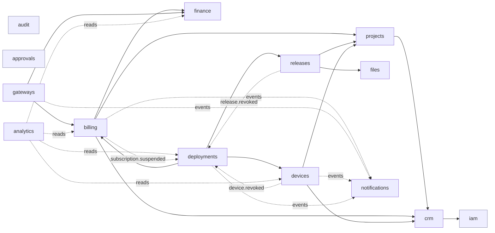

# Modullar va ular orasidagi bog'lanishlar

> ADS-ERP arxitektura hujjatlari · tasdiqlangan reja (2026-11-10) asosida · [Hujjatlar indeksi](../README.md)

## 4. Modullar va ular orasidagi bog'lanishlar

### 4.1 Backend modullari (bounded context'lar)
| # | Modul | Biznes moduli | Egalik qiladigan jadvallar (asosiy) |
|---|---|---|---|
| 1 | `iam` | Users, Roles & Permissions (+ auth, portal users) | User, Role, Permission, RolePermission, UserRoleAssignment, Session, MfaFactor, Passkey, PortalUser, ApiKey |
| 2 | `approvals` | (cross-cutting) maker-checker | ApprovalPolicy, ApprovalRequest, ApprovalDecision |
| 3 | `audit` | Audit Logs | AuditLog (partitioned), AuditSeal |
| 4 | `crm` | Clients Management | Client, ClientContact, ClientSite, ClientNote, Tag |
| 5 | `projects` | Projects Management | Project, **ProjectComponent**, ProjectMember, ClientProject |
| 6 | `billing` | Subscription Mgmt + Payments | Plan, PlanPrice, Subscription, SubscriptionRevision(+Item), MrrMovement, BillingRun, Invoice, InvoiceLine, CreditNote, Payment, Allocation, Refund |
| 7 | `gateways` | Payments (onlayn) | PaymentOrder(+Target), GatewayTransaction, GatewayEvent, PaymentProviderConfig |
| 8 | `finance` | Finance | LedgerAccount, JournalEntry, JournalLine, FinancialPeriod, FxRate, DocumentSequence, MrrSnapshot, ArAgingSnapshot, Expense |
| 9 | `devices` | Devices Management | Device, EnrollmentToken, DeviceCredential, DeviceInstallation, DeviceEvent, DeviceCommand |
| 10 | `releases` | Software Version Mgmt | Release, ReleaseArtifact, ReleaseChannel(+Entry), TufMetadata |
| 11 | `deployments` | Deployment Management | Deployment, DeploymentWave, DeploymentTarget, DeploymentTargetEvent |
| 12 | `files` | File Management | File, Folder, FileAttachment, UploadSession |
| 13 | `notifications` | Notifications | NotificationTemplate, Notification, NotificationPreference, ChannelIdentity (Telegram chat) |
| 14 | `analytics` | Dashboard + Analytics & Reports | MetricSnapshot, MrrSnapshot, ReportJob, SavedView |
| 15 | `system` | (platform) | OutboxEvent, IdempotencyRecord, Setting, FeatureFlag |

### 4.2 Bog'liqlik xaritasi
Qattiq chiziq = sinxron facade chaqiruv (bitta tranzaksiya ichida bo'lishi mumkin). Punktir = asinxron domain event (outbox orqali).

`iam`, `audit`, `approvals`, `system` — hamma modul ishlatadigan **cross-cutting** modullar (grafda soddalik uchun strelkalar ko'rsatilmagan). Sikl (cycle) taqiqlangan — `dependency-cruiser` tekshiradi.

### 4.3 Asosiy modullararo kontraktlar
| Iste'molchi | Ta'minotchi facade | Metod (misol) | Nega sinxron |
|---|---|---|---|
| billing | finance | `LedgerService.post(tx, entries)` | invoice/payment va ledger yozuvi bitta tranzaksiyada |
| billing | finance | `FxService.rateOn(date, from, to)` | to'lov paytidagi kurs snapshot |
| gateways | billing | `PaymentService.recordGatewayPayment(tx, …)` | gateway "perform" bilan to'lov atomik |
| deployments, agent-gateway | billing | `EntitlementService.entitlement(clientId, projectId, at)` → `FULL` \| `SECURITY_ONLY` \| `NONE` (Redis cache, event bilan invalidatsiya) | update/artefakt URL berishdan oldin obuna tekshiruvi |
| deployments | releases | `ReleaseService.getSignedManifest(releaseId, platform, arch)` | desired-state hisoblash |
| releases, crm, billing | files | `FileService.attach(tx, fileId, entity)` / `presignDownload()` | |
| barcha | audit | `AuditService.record(tx, entry)` | audit yozuvi biznes o'zgarish bilan atomik |
| barcha | approvals | `ApprovalService.require(policy, payload)` | maker-checker gate |

### 4.4 Event katalogi (outbox → BullMQ)
| Ishlab chiqaruvchi | Event'lar | Asosiy iste'molchilar |
|---|---|---|
| crm | `client.created/updated/archived` | analytics, notifications |
| projects | `client_project.linked/unlinked` | billing (obuna yaratish tavsiyasi), analytics |
| billing | `subscription.created/activated/changed/past_due/suspended/reactivated/cancelled/expired`, `invoice.finalized/paid/overdue/voided`, `credit_note.issued`, `payment.posted/refunded`, `allocation.applied`, `credit.autoapply` | notifications, deployments (gating), analytics (MRR), allocator |
| gateways | `gateway.txn.created/performed/cancelled`, `gateway.reconciliation.mismatch` | notifications (finance team), audit |
| finance | `fx.rate.updated` | analytics |
| devices | `device.enrolled/online/offline/revoked/inventory_changed`, `device.command.completed` | notifications, deployments, analytics |
| releases | `release.uploaded/verified/published/deprecated/revoked` | deployments, notifications |
| deployments | `deployment.started/wave_advanced/paused/completed/failed/cancelled`, `deployment.target.succeeded/failed/rolled_back` | notifications, analytics |
| files | `file.scanned/quarantined` | releases (artefakt tayyor), notifications |
| iam | `user.invited/locked/role_changed`, `auth.login_failed_burst` | notifications (security alert), audit |

Har event: `{ id (uuidv7), type, version, occurredAt, actor, correlationId, aggregateType, aggregateId, payload }` — Zod schema `packages/contracts/events`. Consumer'lar **idempotent** (`processed_events(consumer, event_id)` unique).
