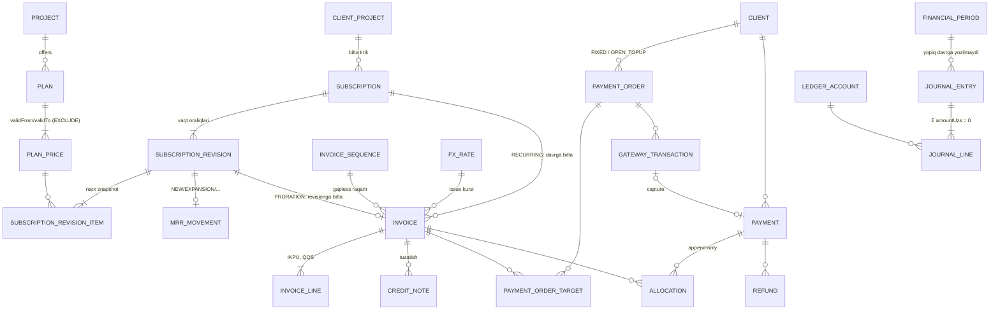

# Billing, multi-currency va to'lov tizimlari

> ADS-ERP arxitektura hujjatlari · tasdiqlangan reja (2026-11-10) asosida · [Hujjatlar indeksi](../README.md)

## 7. Billing, multi-currency va to'lov tizimlari dizayni

> Bu bo'lim mening dizaynim va mustaqil arxitektor-agent dizaynini solishtirib, kuchliroq yechimlarni birlashtirish natijasi. Uchinchi tomon API'lari bo'yicha: **[V]** — provider rasmiy hujjati bilan tekshirilgan, **[U]** — tasdiqlanmagan (P10 — integratsiya bosqichi boshida sandbox bilan tasdiqlanadi).

### 7.1 Pul, valyuta va soliq qoidalari
- **Summalar — `BigInt` minor units** (tiyin/sent) + `Currency` enum (`UZS`, `USD`). **Kurs** — `Decimal(18,6)`, doim "1 USD = X UZS" (teskari kurs saqlanmaydi).
  - Nega BigInt: Payme summani butun tiyinda yuboradi **[V]**; butun sonlar yig'indisi aniq; DB CHECK formulalari oddiy; `Decimal(18,2)` ustunga ko'p xonali qiymat yozilsa PostgreSQL uni **jimgina yaxlitlaydi** (silent scale drift) — BigInt'da bu imkonsiz. `Int` emas: 2³¹ tiyin ≈ 21.5 mln so'm — bitta yillik invoice sig'maydi.
  - Yagona arifmetika: `mulDivRound()` (half away from zero = PostgreSQL `round(numeric)`) → DB CHECK'lar ilova hisobini aynan takrorlaydi. Kurs ilovada scaled bigint (×10⁶).
  - Wire format: `{"amountMinor":"134334000","currency":"UZS"}` (string); global serializer `bigint → string`; lint qoidasi pul tiplarida `Number()`/`parseFloat`ni taqiqlaydi.
- **Valyuta qonunchiligi [firma ro'yxatdan o'tgach, yurist bilan]:** rezidentlar o'rtasidagi hisob-kitob odatda UZS'da — USD'da narxlangan obuna UZS'da kurs bo'yicha to'lanadi; qo'lda USD to'lov faqat `Client.isResident = false` uchun. Hozircha bu cheklov ilovada majburlanmaydi.
- **Soliq va fiskalizatsiya:** hozircha **yuridik shaxs yo'q → QQS 0** (`vatRateBp` default 0). Firma ochilgach (integratsiya bosqichi): QQS stavkasi data-driven (IT Park imtiyozlari), narx va invoice qatorlarida **IKPU** kodi, onlayn to'lovda fiskal chek (Payme `CheckPerformTransaction.detail` + `SetFiscalData` **[V]**), e-faktura operatori.
- Yaxlitlash qator darajasida; jami = qatorlar yig'indisi (finalizatsiyada DB trigger tekshiradi).

### 7.2 Asosiy modellash qarorlari
1. `ClientProject` — M:N yadro; unda bir vaqtda **bitta "tirik" obuna** (filiallar → `quantity`, qo'shimcha modullar → revision item'lar, alohida yuridik shaxs → alohida mijoz).
2. Obuna valyutasi umrbod o'zgarmaydi (o'zgartirish = bekor qilish + yangi obuna).
3. **`SubscriptionRevision`** — shartlar (status, narxlar, miqdor, chegirma) ustma-ust tushmaydigan vaqt oraliqlarida (`EXCLUDE` constraint). Hech narsa ustidan yozilmaydi: har o'zgarish = yangi revision. MRR, proration va audit uchun yagona manba.
4. **To'lov ≠ hisob-kitob:** append-only `Allocation` to'lovni invoice'ga bog'laydi, kursni va realized FX farqini saqlaydi; bekor qilish — aniq manfiy reversal. Mijoz kredit balansi = POSTED to'lovlarning taqsimlanmagan qismi (hosila — "drift" qilolmaydi).
5. **Gateway callback'lari invoice'ga tegmaydi:** capture faqat `GatewayTransaction` + `Payment` + journal + outbox yozadi; idempotent **allocator job** keyin taqsimlaydi. Billing'dagi xato hech qachon gateway yechib olgan pulni rad etishga olib kelmaydi.
6. Yakunlangan hujjat o'zgarmaydi: tuzatish — `CreditNote` va allocation reversal.
7. Kichik **double-entry sub-ledger** (AR, avanslar, gateway clearing, QQS, FX) — har hodisa bilan bitta tranzaksiyada; statutory buxgalteriyaga (1C) eksport qilinadi, uni almashtirmaydi.
8. Billing davri — **kalendar oy** (1-sanadan keyingi oyning 1-sanasigacha); birinchi to'liq bo'lmagan oy kunlik proration bilan (oylik "bajarilgan ishlar dalolatnomasi" amaliyotiga mos).
9. Har mijozda **`accountNo`** (8 raqam, Luhn) — mijoz Payme/Click/Uzum ilovasida shu raqamni kiritib balansini to'ldiradi (`OPEN_TOPUP`); portal/Telegram havolalari esa `FIXED` buyurtma (summa va kurs qulflangan).
10. Qo'lda kiritilgan to'lovni **rahbar tasdiqlaydi** (tasdiqlangan qaror): `PENDING_APPROVAL → POSTED` faqat `payments:approve` ruxsati bor xodim (**Rahbar** roli) tasdig'i bilan — DB trigger tekshiradi. Rahbar o'zi kiritgan to'lovni o'zi tasdiqlashi mumkin; buxgalter o'zinikini — yo'q. Refund (`refunds:approve`) va credit note (`credit_notes:approve`) — xuddi shu tartib. Rahbar bu ruxsatni **menejer akkauntiga** doimiy yoki muddatli berishi mumkin; muddat tugagach menejer tasdiqlay olmaydi (DB funksiyasi `ads_user_has_permission` muddatni tekshiradi). Har tasdiq so'rovi rahbarga Telegram orqali yuboriladi.

### 7.3 Billing/Finance ER


### 7.4 Prisma modellari (billing, gateways, finance)
To'liq, `prisma validate` va PostgreSQL'da tekshirilgan schema: [database/prisma-schema.md](database/prisma-schema.md) (`billing.prisma`, `gateways.prisma`, `finance.prisma` bo'limlari).

### 7.5 Prisma ifoda qila olmaydigan integrity qoidalari (raw SQL migratsiya)
Asosiy namunalar (to'liq to'plam: [database/integrity.sql](database/integrity.sql)):
```sql
-- 1) Append-only: allocations, credit_notes, journal_entries, journal_lines, gateway_events, fx_rates,
--    mrr_movements, subscription_revision_items, payment_order_targets, audit_logs, device_events
CREATE FUNCTION forbid_mutation() RETURNS trigger LANGUAGE plpgsql AS $$
BEGIN RAISE EXCEPTION '% on % is forbidden (append-only)', TG_OP, TG_TABLE_NAME; END $$;
CREATE TRIGGER allocations_append_only BEFORE UPDATE OR DELETE ON allocations
  FOR EACH ROW EXECUTE FUNCTION forbid_mutation();

-- 2) Invoice: summalar/holat izchilligi va billing idempotentligi
ALTER TABLE invoices
  ADD CONSTRAINT inv_amounts_ck CHECK (total_minor = subtotal_minor + vat_minor AND total_minor >= 0
      AND paid_minor >= 0 AND credited_minor >= 0 AND paid_minor + credited_minor <= total_minor),
  ADD CONSTRAINT inv_state_ck CHECK (
        ((status = 'DRAFT') = (number IS NULL AND finalized_at IS NULL))
    AND ((status = 'VOID')  = (voided_at IS NOT NULL))
    AND (status <> 'VOID' OR paid_minor = 0)
    AND (status IN ('DRAFT','VOID') OR ((status = 'PAID') = (paid_minor + credited_minor = total_minor))));
CREATE UNIQUE INDEX inv_one_recurring_per_period ON invoices (subscription_id, period_start)
  WHERE kind = 'RECURRING' AND status <> 'VOID';      -- billing run idempotentligining HAQIQIY kafolati
CREATE UNIQUE INDEX inv_one_proration_per_revision ON invoices (revision_id)
  WHERE kind = 'PRORATION' AND status <> 'VOID';

-- 3) Allocation → hisoblagichlar (ilova paid_minor/allocated_minor'ga hech qachon yozmaydi)
CREATE FUNCTION allocation_apply() RETURNS trigger LANGUAGE plpgsql AS $$
BEGIN
  UPDATE payments SET allocated_minor = allocated_minor + NEW.amount_payment_minor
   WHERE id = NEW.payment_id AND status = 'POSTED';    -- lock tartibi: avval payment, keyin invoice
  IF NOT FOUND THEN RAISE EXCEPTION 'payment % is not POSTED', NEW.payment_id; END IF;
  UPDATE invoices SET paid_minor = paid_minor + NEW.amount_invoice_minor,
         status = CASE WHEN paid_minor + NEW.amount_invoice_minor + credited_minor = total_minor
                       THEN 'PAID'::"InvoiceStatus"
                       WHEN status = 'PAID' THEN 'OPEN'::"InvoiceStatus" ELSE status END
   WHERE id = NEW.invoice_id AND status IN ('OPEN','PAID','UNCOLLECTIBLE');
  IF NOT FOUND THEN RAISE EXCEPTION 'invoice % is not allocatable', NEW.invoice_id; END IF;
  RETURN NULL;
END $$;
CREATE TRIGGER allocation_apply AFTER INSERT ON allocations FOR EACH ROW EXECUTE FUNCTION allocation_apply();
ALTER TABLE payments ADD CONSTRAINT pay_amounts_ck CHECK (amount_minor > 0 AND allocated_minor >= 0
  AND refunded_minor >= 0 AND allocated_minor + refunded_minor <= amount_minor);  -- ortiqcha taqsimlash imkonsiz

-- 4) Ledger: har entry balanslangan, yopiq davrga yozib bo'lmaydi
CREATE FUNCTION journal_balanced() RETURNS trigger LANGUAGE plpgsql AS $$
BEGIN
  IF (SELECT coalesce(sum(amount_uzs_minor), 0) FROM journal_lines WHERE entry_id = NEW.entry_id) <> 0 THEN
    RAISE EXCEPTION 'journal entry % unbalanced', NEW.entry_id; END IF;
  RETURN NULL;
END $$;
CREATE CONSTRAINT TRIGGER journal_balanced AFTER INSERT ON journal_lines
  DEFERRABLE INITIALLY DEFERRED FOR EACH ROW EXECUTE FUNCTION journal_balanced();

CREATE FUNCTION period_lock() RETURNS trigger LANGUAGE plpgsql AS $$
DECLARE closed timestamptz;
BEGIN
  SELECT closed_at INTO closed FROM financial_periods
   WHERE month = date_trunc('month', NEW.effective_date)::date FOR SHARE;
  IF NOT FOUND OR closed IS NOT NULL THEN
    RAISE EXCEPTION 'period of % is closed or not opened', NEW.effective_date; END IF;
  RETURN NEW;
END $$;
CREATE TRIGGER period_lock BEFORE INSERT ON journal_entries FOR EACH ROW EXECUTE FUNCTION period_lock();
```

Qolgan qoidalar (xuddi shu migratsiyalarda):
| Jadval | Qoida |
|---|---|
| `subscriptions` | Trigger: faqat ruxsat etilgan o'tishlar (TRIALING→ACTIVE/EXPIRED/CANCELLED; ACTIVE→PAST_DUE/CANCELLED/EXPIRED; PAST_DUE→ACTIVE/SUSPENDED/CANCELLED; SUSPENDED→ACTIVE/CANCELLED); `client_id, client_project_id, currency` o'zgarmas; CHECK status ↔ `ended_at`/`past_due_since`; partial unique — bitta tirik obuna per `client_project_id` |
| `subscription_revisions` | `EXCLUDE USING gist (subscription_id WITH =, tstzrange(valid_from, valid_to) WITH &&)`; bitta ochiq revision (partial unique); trigger: faqat `valid_to` bir marta yopiladi |
| `plan_prices` | `EXCLUDE USING gist (plan_id, currency, daterange(valid_from, valid_to))` (`btree_gist`) |
| `invoices` | Trigger: finalizatsiyadan keyin faqat `paid/credited/status/voided_at` o'zgaradi; finalizatsiyada Σ qatorlar = jami; faqat DRAFT o'chiriladi; USD'da `total_uzs_minor = round(total × rate)` |
| `invoice_lines` | CHECK: `amount = round(qty × unit × num / den)`, `vat = round(amount × bp / 10000)`; trigger: faqat DRAFT invoice qatorlari o'zgaradi |
| `payments` | Trigger: faqat hisoblagich/status/approved_by o'zgaradi (`PENDING_APPROVAL → POSTED/REJECTED`); CHECK: gateway metodi ⇔ `gateway_transaction_id`; qo'lda to'lov POSTED bo'lsa tasdiqlovchi majburiy va unda **`payments:approve` ruxsati** bo'lishi shart (trigger, rahbar o'zinikini tasdiqlay oladi); partial unique `(method, external_ref)` |
| `allocations` | CHECK: ishoralar mosligi, `fx_diff = settled − carrying`, cross-currency tolerantlik ≤ 1 so'm; trigger: reversal asl yozuvni aynan inkor qiladi |
| `credit_notes`, `refunds` | Apply-trigger'lar (`credited_minor`, `refunded_minor`); refund state machine; tasdiqlovchida `credit_notes:approve` / `refunds:approve` ruxsati (trigger) |
| `gateway_transactions` | Trigger: PENDING→SUCCEEDED/CANCELLED, SUCCEEDED→REFUNDED; vaqt maydonlari bir marta yoziladi; partial unique — FIXED buyurtmada bitta tirik tranzaksiya |
| `journal_entries` | Deferred trigger: ≥ 2 qator |
| `clients` | CHECK `account_no ~ '^\d{8}$'` (+ ilovada Luhn), `tin ~ '^\d{9}$'` |
| Huquqlar | Runtime rol (`app_rw`) jadval egasi **emas** (ega trigger'ni o'chira oladi!); append-only jadvallarda UPDATE/DELETE va hamma joyda TRUNCATE REVOKE |

- **Tekshirildi (2026-11-10):** partial unique'lar Prisma 7.10.1 `partialIndexes` preview bilan schema'da (`@@unique(..., where: raw(...))`); CHECK/EXCLUDE/trigger/RLS/partition — [integrity.sql](database/integrity.sql) da. Schema + integrity.sql PostgreSQL 18.6 da qo'llanib, **112/112** test o'tdi (v2) va Prisma drift diff'i bo'sh chiqdi — [integrity-tests.md](database/integrity-tests.md). Yuqoridagi jadval qisqa ko'rinish; **yagona manba — integrity.sql**.
- **CI "constraint catalog" testi:** migratsiyalar bo'sh DB'ga qo'llanadi → `pg_constraint`, `pg_trigger`, `pg_indexes` da har kutilgan nom borligi tekshiriladi; generatsiya qilingan migratsiyada ruxsatsiz `DROP INDEX/CONSTRAINT/TRIGGER` bo'lsa CI yiqiladi.
- **Tungi integrity checker** (trigger bilan emas, tekshiruv bilan): `mrr_minor = Σ items`; hisoblagichlar = Σ allocations/refunds; ledger 1200 AR (mijoz, valyuta) = ochiq invoice qoldiqlari; 2100 Avanslar = taqsimlanmagan to'lovlar. Nomuvofiqlik → critical alert.
- Prisma'da `FOR UPDATE` yo'q → qulflash `$queryRaw`/TypedSQL orqali; interactive transaction timeout ≈ 10 s; 40001/40P01/P2034 xatolarida exponential retry.

### 7.6 Invoice raqamlash va oylik billing run
- **Raqamlash:** DRAFT raqamsiz. Finalizatsiyada, o'sha tranzaksiyada: `UPDATE document_sequences SET next_value = next_value + 1 WHERE series = 'INV' AND year = $y RETURNING next_value - 1` → `INV-2026-000123`. Row lock finalizatsiyalarni ketma-ket qiladi; rollback raqamni qaytaradi → **gapless**. VOID invoice raqamini saqlaydi; credit note'lar — `CN` seriyasi.
- **Billing run:**
  1. BullMQ scheduler `10 0 * * *` (`tz: Asia/Tashkent`) → `status IN ('ACTIVE','PAST_DUE') AND next_billing_on <= today` (keyset pagination) → har obunaga job, `jobId = bill:{subId}:{nextBillingOn}` (BullMQ dedupe faqat shovqinni kamaytiradi, kafolat emas).
  2. Worker, bitta Read Committed tranzaksiya: obunani `SELECT … FOR UPDATE` → davrni qulflangan qatordan qayta hisoblash (payload — faqat kutish) → `periodStart` dagi revision → RECURRING invoice INSERT (**`inv_one_recurring_per_period` — haqiqiy idempotency**; P2002 → "allaqachon chiqarilgan") → finalizatsiya (raqam, `issueDate`, `dueDate = issue + terms`, USD uchun issue kunidagi CBU kursi) → journal (`invoice:{id}:finalize`) → davr va `nextBillingOn` ni surish → outbox (`invoice.finalized`, `credit.autoapply`).
  3. Telegram/email/eksport — faqat outbox'dan, `eventKey` bo'yicha dedupe.
  4. Retry: 40001/40P01/P2034 → backoff; boshqa constraint xatosi → alert (retry emas). Catch-up: bitta tranzaksiyada bitta davr, maksimum 3; undan ko'p → qo'lda ko'rib chiqish.
  5. Tarif o'zgarishi, bekor qilish, dunning ham shu obuna qatorini qulflaydi → billing bilan ketma-ket.
  6. **Tranzaksiya ichida tarmoq chaqiruvi yo'q** (kurslar oldindan olinadi).
- **Dunning (kunlik):** shartli update'lar (`… SET status='PAST_DUE' WHERE id=$1 AND status='ACTIVE' AND EXISTS(muddati o'tgan ochiq invoice)`), har biri revision + outbox yozadi. Eslatmalar: D−3, D0, D+1, grace tugashidan 2 kun oldin, SUSPENDED. **SUSPENDED** — invoice chiqarish to'xtaydi; qayta aktivlashganda oyning qolgan qismi prorated.

### 7.7 Proration siyosati
| Holat | Qoida |
|---|---|
| Birinchi to'liq bo'lmagan oy | Kunlik: `round(qty × unit × daysCharged / daysInMonth)`; kasr qatorda saqlanadi (CHECK qayta hisoblaydi) |
| Upgrade / miqdor oshishi | Darhol; oyning qolgan kunlari uchun alohida PRORATION invoice (kalit: `revisionId`) |
| Downgrade / kamayish | Keyingi oyning 1-sanasidan (scheduled revision); kredit berilmaydi |
| Bekor qilish | Default — davr oxirida; darhol bekor qilishda avtomatik refund yo'q (credit note — qo'lda, four-eyes) |
| Tarif narxi o'zgarishi | Mavjud obunalar eski narxda qoladi (revision item snapshot); yangi narxga o'tkazish — ogohlantirish bilan scheduled revision |

Natija: oddiy ish jarayonida manfiy proration, credit note yoki tuzatuvchi e-faktura yo'q; har invoice aynan bitta davrga mos.

### 7.8 Valyutalararo hisob-kitob va FX farqi
- **USD invoice** issue kunidagi CBU kursini snapshot qiladi → `totalUzsMinor` = daromad va AR'ning UZS carrying value'si.
- **Portal/Telegram'dan USD invoice'ni to'lash:** FIXED `PaymentOrder` yaratiladi — har target uchun `uzs = ceilToWholeSum(qoldiqSent × bugungiKurs)`, `expiresAt` = Toshkent kuni oxiri. Muddat ichida **yaratilgan** gateway tranzaksiyasi uchun kotirovka amal qiladi (Payme perform'ni 12 soatgacha kechiktirishi mumkin **[V]**).
- **Allocation** (allocator job): `settledUzs = amountPaymentMinor`; `carryingUzs` = invoice `totalUzsMinor` ning pro-rata ulushi (oxirgi allocation qoldiqni oladi → yig'indi aynan `totalUzsMinor`); `fxDiff = settled − carrying` → 7100 FX foyda / 7200 FX zarar.
- **Misol:** $112.00 invoice 12 000.00 kursida → carrying 1 344 000.00 so'm; 12 100.00 kotirovkada to'landi → 1 355 200.00 so'm → **FX foyda 11 200.00 so'm**.
- Invoice orada qisman to'langan bo'lsa — faqat qoldiq taqsimlanadi, ortig'i kreditga. ≤ 1 so'm kamomad invoice'ni yopadi (CHECK'dagi tolerantlik).
- Norezidentning USD o'tkazmasi — xuddi shu mexanizm (`settledUzs` — qabul sanasi kursi). Keyinroq USD invoice'ga qo'llangan UZS kredit — o'sha kun kursida.
- FX farqlari daromad va MRR'ga **tegmaydi**.
- **Oy oxiri qayta baholash (tasdiqlangan qaror):** oy yopilishida har ochiq USD invoice'ning qoldig'i oy oxiridagi CBU kursida qayta baholanadi: `Δ = qoldiqSent × (oyOxiriKursi − carryingKursi)` → **unrealized** FX yozuvi (`1200 AR` USD qatori: 0 sent, ±UZS ↔ `7150`/`7250`), idempotency kaliti `fxreval:<oy>:<invoiceId>`. Keyingi oyning 1-sanasida avtomatik **reversal** — shuning uchun to'lov paytidagi realized FX hisobi (carrying value bo'yicha) o'zgarmaydi. `financial_periods.fx_revalued_at` belgilanmaguncha oyni yopib bo'lmaydi (DB CHECK).

### 7.9 Ledger posting qoidalari
| Hodisa | Debet | Kredit |
|---|---|---|
| Invoice finalizatsiyasi | 1200 AR (invoice valyutasi; UZS — issue kursida) | 4000 Daromad (loyiha bo'yicha), 2200 QQS |
| Gateway capture | 1150/1151/1152 Clearing (UZS) | 2100 Mijoz avanslari |
| Qo'lda to'lov (POSTED) | 1000 Kassa yoki 1020 Bank | 2100 Mijoz avanslari |
| Allocation | 2100 Avanslar (settledUzs) | 1200 AR (carryingUzs) ± FX foyda/zarar qatori |
| Credit note | 4000 Daromad, 2200 QQS | 1200 AR |
| Refund | 2100 Avanslar | Clearing yoki Bank |
| Gateway settlement (bank ko'chirmasi) | 1020 Bank, 6100 Gateway komissiyasi | Clearing |
| Oy oxiri FX qayta baholash (unrealized) | 1200 AR (USD qatori: 0 sent, +UZS) yoki 7250 | 7150 yoki 1200 AR (−UZS) — keyingi oy 1-sanasida reversal |

**Akt-sverka** (mijoz bilan solishtirma dalolatnoma) = davr uchun 1200 AR va 2100 Avanslar bo'yicha `clientId` kesimidagi qoldiq va aylanmalar (valyuta bo'yicha).

### 7.10 To'lov tizimlari (Payme, Click, Uzum)
> **Holat:** integratsiya **P10 (integratsiya bosqichi)** ga ko'chirildi — firma ro'yxatdan o'tib, merchant akkauntlar ochilgach. Dizayn, schema va DB qoidalari tayyor; hozircha to'lovlar qo'lda kiritiladi va rahbar tasdiqlaydi.
**Yagona ichki state machine:**
| Ichki holat | Payme | Click | Uzum **[U]** |
|---|---|---|---|
| faqat validatsiya | CheckPerformTransaction | (Prepare ichida) | check |
| PENDING | CreateTransaction → state 1 | Prepare muvaffaqiyatli | create |
| SUCCEEDED (+ Payment POSTED) | PerformTransaction → state 2 | Complete, `error = 0` | confirm |
| CANCELLED | Cancel (state 1 da) → −1; 12 soat timeout → reason 4 | Complete, `error < 0` → javob −9 | reverse (confirm'dan oldin) |
| REFUNDED (+ Refund) | Cancel (state 2 da) → −2 (faqat tasdiqlangan refund bo'lsa) | out-of-band (Merchant API) | reverse (confirm'dan keyin) |

**Payme Merchant API** (Payme bizni chaqiradi):
- **[V]** JSON-RPC 2.0, HTTPS POST, javob doim HTTP 200; metodlar: CheckPerformTransaction, CreateTransaction, PerformTransaction, CancelTransaction, CheckTransaction, **GetStatement (majburiy)**, SetFiscalData (ixtiyoriy); summa — musbat butun tiyin; vaqt — 13 xonali ms; `id` — 24 belgili string; holatlar 1/2/−1/−2; cancel reason'lar 1, 2, 3, 4 (timeout), 5 (refund), 10; **timeout — yaratilgandan 43 200 000 ms (12 soat)**; xato kodlari −32300, −32700, −32600, −32601, −32504 (auth), −32400, −31001 (summa), −31003 (topilmadi), −31007 (bekor qilib bo'lmaydi — xizmat ko'rsatilgan), −31008 (holat ruxsat bermaydi), −31050…−31099 (account xatolari, lokalizatsiyalangan `message`); fiskalizatsiya uchun CheckPerformTransaction `detail` (`items[{title, price, count, code (IKPU), package_code, vat_percent}]`); refund merchant kabinetidan boshlanadi va bizga performed tranzaksiyada CancelTransaction bo'lib keladi.
- **[U]** Basic auth (`Paycom` + kassa kaliti), Payme IP diapazonlari, bitta martalik buyurtmada PENDING tranzaksiya turganda ikkinchi Create'ga −31050…−31099 qaytarish (sandbox testlari kutadi).
- Handler mantiqi:
```text
Create(id,time,amount,account): tx := SELECT … FOR UPDATE by (PAYME,id)
  bor: state≠PENDING → -31008; now−time > 12h → CANCELLED(4), -31008; aks holda {create_time, transaction: seq, state:1} qaytariladi
  yo'q: Check kabi validatsiya → -31001 / -31050..; FIXED buyurtmada tirik tx bor → -31099 (index kafolati); INSERT PENDING
Perform(id): yo'q → -31003; PENDING va muddati o'tgan → CANCELLED(4), -31008;
  PENDING → SUCCEEDED + Payment(POSTED) + receipt journal + outbox(allocate); SUCCEEDED → replay; aks holda -31008
Cancel(id,reason): yo'q → -31003; PENDING → CANCELLED → -1;
  SUCCEEDED → faqat to'liq summaga APPROVED Refund bo'lsa → REFUNDED → -2, aks holda -31007
  CANCELLED/REFUNDED → saqlangan cancel_time/state replay
```
**Click SHOP API:** **[V]** Prepare (`action=0`) → Complete (`action=1`); `sign_string = md5(click_trans_id + service_id + SECRET_KEY + merchant_trans_id [+ merchant_prepare_id] + amount + action + sign_time)` (`merchant_prepare_id` faqat Complete'da); kodlar 0, −1 (imzo), −4 (allaqachon to'langan), −6 (topilmadi), −7, −8, −9 (bekor qilingan); Click `error < 0` yuborsa — bekor qilish va −9; muvaffaqiyatli Prepare + karta yechilgandan keyin Complete'ga −4/−9 dan boshqa xato qaytarilmaydi. **[U]** −2/−3/−5 kodlari, `amount` formati (masalan `1000.0`) — **MD5 doim qabul qilingan xom string bo'yicha hisoblanadi**, `sign_time` formati, refund'lar Merchant API orqali.
**Uzum Bank Merchant API:** asosan **[U]** — taxminan 5 ta webhook endpoint (check, create, confirm, reverse, status), tiyin, Basic auth. Rasmiy spetsifikatsiya account-menejer orqali olinmaguncha maydon nomlari noma'lum deb hisoblanadi.

**Barcha adapterlar uchun qoidalar:**
1. `(provider, externalId)` bo'yicha bitta qator: `INSERT … ON CONFLICT DO NOTHING` → `SELECT … FOR UPDATE`; replay'lar saqlangan vaqtlarni qaytaradi.
2. **Validatsiya rad etishi mumkin, capture — yo'q** (faqat protokol sabablari bilan). Ortiqcha pul → kredit.
3. Har so'rov `GatewayEvent` ga (xom body + javob) **alohida tranzaksiyada** yoziladi — xatolar ham saqlanadi; sirlar redacted.
4. Callback ichida tashqi I/O yo'q. IP allowlist + auth/imzo tekshiruvi raw body bo'yicha.
5. Har account raqamida Luhn check digit — ilovada xato terilgan raqamni ushlaydi.
6. **Rekonsiliatsiya (kunlik, uch tomonlama):** gateway tranzaksiyalari ↔ provider reyestri (kabinet hisobotlari/API) ↔ bank ko'chirmasi; farqlar — exceptions navbati; oy faqat nol farq bilan yopiladi.

### 7.11 Moliyaviy analitika: MRR, harakatlar, churn, aging
- **MRR (revision bo'yicha)** = Σ items `round(qty × unit × (1 − discount) / intervalMonths)`; QQS, bir martalik to'lovlar va proration'siz. Faqat ACTIVE va PAST_DUE hisoblanadi (TRIALING/SUSPENDED — yo'q; siyosat revision'lardan tarixan qayta hisoblanadi).
- **Harakatlar** revision o'zgarishi bilan bitta tranzaksiyada (mijoz qatori qulflanadi, mijozning o'zgarishdan oldingi/keyingi MRR'i): 0 → >0 = NEW (avval MRR bo'lgan bo'lsa — REACTIVATION); >0 → 0 = CHURN; aks holda ishoraga qarab EXPANSION/CONTRACTION. Valyutadan mustaqil; UZS hisobotida har harakat o'z sanasi kursida.
- **Oylik ko'prik:** `MRR_end = MRR_start + Σ movements + FX effekti` (FX alohida ko'rsatiladi).
- **Churn/retention:** logo churn = oydagi CHURN / oy boshida MRR > 0 bo'lgan mijozlar; gross revenue churn = (churn + contraction) / oy boshidagi MRR (doimiy valyutada); NRR = (start + expansion − contraction − churn) / start.
- **Aging (istalgan o'tgan sana D uchun):** outstanding = total − Σ allocations (`appliedAt` < D+1) − Σ credit notes (< D+1); bucket'lar `D − dueDate` bo'yicha (0–30/31–60/61–90/90+); USD qoldiqlar D kursida va carrying value'da.
- **Snapshot qilinadigan narsalar:** revision item narxi, revision holati va muddati, CBU kurslari (har hujjatga ham nusxa), invoice'dagi mijoz rekvizitlari, o'zgarmas invoice qatorlari va harakatlar jurnali; oy yopilganda `MrrSnapshot` va `ArAgingSnapshot`. Yopilgan oylar faqat snapshot'lardan hisobot qilinadi.
- **Entitlement (update'larga ruxsat)** — 8.8 ga qarang: TRIALING/ACTIVE/PAST_DUE → to'liq; SUSPENDED → faqat `security: true` update'lar; CANCELLED/EXPIRED → artefakt URL berilmaydi.
