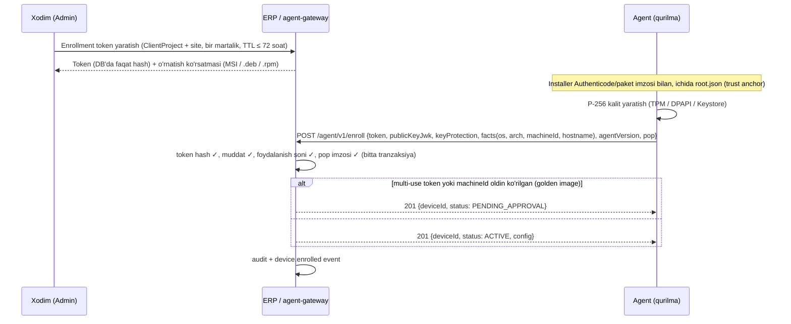
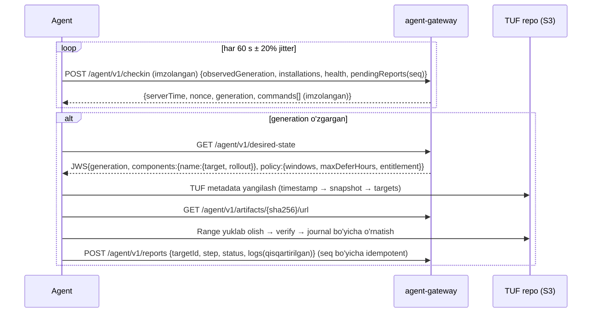

# Secure Update Agent

> ADS-ERP arxitektura hujjatlari · tasdiqlangan reja (2026-11-10) asosida · [Hujjatlar indeksi](../README.md)

> **Holat (v3):** bu hujjat — **maqsadli (kelajakdagi) dizayn**. Birinchi versiyada (P0–P8) qurilmalar faqat saytda reyestr va qo'lda kuzatuv sifatida yuritiladi. Qurilma agenti **P9** da, avval soddalashtirilgan ko'rinishda: imzolangan faylni qurilmaga yuborish → imzo va SHA-256 tekshiruvi → ishga tushirish → natijani saytga qaytarish. ESP32 (8.14), Docker/GPU (8.15), AI modellar (8.16) — ehtiyojga qarab, keyin ([ADR-0018](../adr/ADR-0018-management-scope-device-agent-later.md)).

## 8. Secure Update Agent arxitekturasi va protokoli

### 8.1 Kafolatlar
- **G1 — kod yaxlitligi:** qurilma faqat **offline/mustaqil kalitlar threshold'i** bilan imzolangan artefaktlarni o'rnatadi. Markaziy server **to'liq buzilsa ham** yangi kod o'rnatib bo'lmaydi; buzg'unchi faqat update'larni ushlab qolishi, imzolangan versiyalar (security floor'dan yuqori) orasidan tanlashi, jadvalni o'zgartirishi, komponentni restart qilishi va hisobotlarni o'qishi mumkin.
- **G2:** qurilma kaliti iloji boricha **eksport qilinmaydigan** (TPM / Android Keystore).
- **G3:** qurilmadagi har qadam jurnalga yoziladi; commit'dan oldingi xato qurilmani oxirgi ishlagan holatiga qaytaradi.
- **G4:** qurilma cheksiz muddat oflayn ishlay oladi (dastur ishlashda davom etadi).
- **ESP32 uchun** G1 apparat ildizi orqali ta'minlanadi: **Secure Boot V2** faqat offline kalit bilan imzolangan firmware'ni yuklaydi, imzolangan manifest + eFuse anti-rollback (8.14). Mikrokontrollerda to'liq TUF klienti yo'q.

### 8.2 Komponentlar
| Komponent | Joyi | Vazifa |
|---|---|---|
| `ads-supervisor` | Qurilma (OS servisi: Windows Service / systemd) | Juda kichik, kam o'zgaradi; agent core'ni A/B slotdan ishga tushiradi, watchdog, trial-commit/revert |
| `ads-agent` core (Go) | Qurilma | Identity, check-in, TUF klient (go-tuf v2), reconcile, download, install, health, rollback, journal (bbolt), buyruqlar |
| Lokal "app SDK" endpoint'lari | Boshqariladigan dastur | `/.well-known/ads/health`, `/.well-known/ads/busy` (masalan, smena ochiq) — agent so'raydi |
| `agent-gateway` | Server (`agent.<d>`) | Enrollment, check-in, desired state, artefakt URL, hisobotlar, buyruqlar |
| TUF repository | S3 (`tuf/` — consistent snapshots) | root/targets/delegated/snapshot/timestamp metadata + hash-prefiksli target'lar |
| `tuf-signer` | **ERP'dan ajratilgan** kichik Go servis (alohida konteyner/host, mTLS) | Faqat online rollar: snapshot (7 kun) va timestamp (1 kun) imzosi |
| `ads-cli` | CI va release manager kompyuteri | Target metadata tayyorlash, KMS/YubiKey bilan imzolash, kalit ceremony'lari |
| ADS firmware SDK | ESP32 (ESP-IDF komponenti, C) | Qurilma identifikatsiyasi, imzolangan check-in, manifest tekshiruvi, `esp_https_ota`, A/B partition + rollback (8.14) |
| OCI registry | Server (`registry.<d>`) | Docker Compose komponentlari uchun image'lar; qurilmalar qisqa muddatli pull-token bilan (8.15) |

### 8.3 Qurilma identifikatsiyasi va so'rov autentifikatsiyasi
| | mTLS sertifikatlar | **Imzolangan so'rov assertion (tanlandi)** | Bearer token |
|---|---|---|---|
| Kalit o'g'irlanishiga chidamlilik | Hardware-bound | Hardware-bound | O'g'irlangan token = to'liq impersonatsiya |
| TLS'ni uzadigan proxy/LB/CDN | Passthrough yoki ishonchli header kerak | Ishlaydi | Ishlaydi |
| Operatsiyalar | Device CA, yangilash, CRL | Faqat ro'yxatdagi public key | Refresh oqimi |
| Replay himoyasi | Kanal darajasida | `jti` + server nonce + body hash | Yo'q |
| Revocation | CRL yoki ilova tekshiruvi | Darhol (DB/Redis flag) | Introspection bo'lsa darhol |

Har so'rovda qurilma kaliti bilan imzolangan JWS (oddiy server-autentifikatsiyali TLS ustida):
```
Authorization: ADS-Sig <JWS compact>
header : {"alg":"ES256","typ":"ads-req+jwt","kid":"<RFC 7638 thumbprint>"}
payload: {"dev":"<deviceId>","htm":"POST","htu":"https://agent.<d>/agent/v1/checkin",
          "bsh":"<b64url sha256(raw body)>","iat":1762761600,"jti":"<128-bit>","nonce":"<server nonce>","seq":18237}
```
- Server: `kid` bo'yicha faol kalit → `htu` **sozlangan public base URL'dan** qayta quriladi (`Host` header'dan emas) → **xom** body hash → nonce yaroqli (HMAC-muhrlangan, ≤ 10 daq) yoki `|iat − now| ≤ 120 s` → `jti` qayta ishlatilmagan (Redis `SET NX EX 900`) → `seq` high-water mark (orqaga ketsa — **klonlangan qurilma** belgisi) → qurilma ACTIVE. Har javob yangi `Agent-Nonce` qaytaradi (qurilma soati muhim emas).
- **Desired state va buyruqlar control-plane kaliti bilan JWS-imzolanadi** (public key TUF target sifatida yetkaziladi) → TLS'ni uzadigan korporativ proxy buyruq soxtalashtira olmaydi.
- Tuzoq: TPM/Android imzosi DER, CNG — r‖s; JWS raw r‖s talab qiladi → normallashtirish.
- **Hamma joyda ECDSA P-256:** TPM 2.0 (PC-Client) RSA-2048 va P-256 ni majburiy qo'llaydi, Ed25519 ni emas; StrongBox — faqat P-256.
  - **Windows:** CNG "Microsoft Platform Crypto Provider" (TPM), machine key, non-exportable (Go'da `crypto.Signer`); fallback — software KSP + DPAPI, ACL faqat SYSTEM.
  - **Linux:** `/dev/tpmrm0` + go-tpm (TSS2 key file); fallback — root-only fayl (0600), ixtiyoriy `systemd-creds`.
  - **Android:** AndroidKeyStore P-256, StrongBox bo'lsa — u; ixtiyoriy Key Attestation.
  - `keyProtection` qurilmada saqlanadi; software-kalitli qurilmalar past ishonch darajasida (hardware fingerprint o'zgarsa — qayta tasdiqlash).

### 8.4 Enrollment

Kalit rotatsiyasi — eski kalit bilan imzolangan, yangi kalitning proof-of-possession'ini o'z ichiga olgan so'rov.

### 8.5 Release imzolash: to'liq TUF (go-tuf v2)
O'zimiz yozgan "TUF'ga o'xshash" subset odatda aynan muhim himoyalarni (root rotatsiyasi, threshold'lar, snapshot izchilligi) tushirib qoldiradi — shuning uchun **standart TUF**.

| Rol | Kalitlar va saqlanishi | Threshold | Muddat |
|---|---|---|---|
| root | **3 ta YubiKey — 3 kishida** (alohida seyf/joy), offline | **2-of-3** | 365 kun |
| targets | O'sha 3 kishining alohida kalitlari (YubiKey'ning boshqa slot'i yoki ikkinchi YubiKey), offline; **faqat delegatsiyalarni** imzolaydi | **2-of-3** | 365 kun |
| `project-<x>` (delegated, `pos/*`) | **Alohida cloud akkauntdagi KMS** (faqat himoyalangan tag'lardan CI) + release manager YubiKey'i | **2-of-2** | 180 kun |
| `agent` (delegated) | CI KMS + 2 ta YubiKey (3 kishidan) | 2-of-3 | 180 kun |
| `firmware` (delegated, ESP32) | Firmware manifest kaliti (offline YubiKey) + Secure Boot V2 imzolash kaliti (offline/HSM) — **2 mustaqil imzo** | 2-of-2 | 180 kun |
| snapshot / timestamp | Online, **izolyatsiyalangan `tuf-signer`** da (ERP'da emas) | 1 | 7 kun / 1 kun |

**Reliz oqimi:** CI build → `ads-cli` target metadata (hash, uzunlik, custom maydonlar) + artefaktni ERP'ga yuklaydi → CI KMS bilan delegated rolning yangi versiyasini imzolaydi (1/2) → release manager ERP'da hash/maydonlar diff'ini ko'rib, `ads-cli release sign` bilan YubiKey'ni bosadi (2/2) → ERP threshold'ni joriy delegatsiyaga nisbatan tekshiradi → `tuf-signer` yangi snapshot + timestamp chiqaradi → S3'ga consistent snapshot sifatida yoziladi → release **READY**. Mustaqil monitor har yangi targets versiyasida alert beradi.

**Rotatsiya va kompromatdan tiklanish:** online kalitlar → root ceremony `N+1.root.json` (klientlar keshlangan timestamp/snapshot'ni tashlaydi); delegated kalit → targets qayta delegatsiya qiladi; root kalitlar threshold'dan kam → root'dan chiqariladi; threshold va undan ko'p → katastrofa (agentlarni out-of-band qayta o'rnatish) — shuning uchun kalitlar 3 kishida, 2-of-3 va alohida saqlanadi; yomon imzolangan reliz → yuqoriroq versiya + **security floor**'ni ko'tarish. Windows binary'lari qo'shimcha **Authenticode** (2023-yildan kalit HSM'da bo'lishi shart); APK imzolash sertifikati digest'i signed metadata'da pin qilinadi.

**Target custom metadata (imzo ostida) — namuna:**
```json
{"pos/pos-server/2.4.1/windows-amd64/pos-server-2.4.1.zip": {
  "length": 48211234, "hashes": {"sha256": "9f2c…", "sha512": "1ab0…"},
  "custom": {"component": "pos-server", "kind": "service_bundle", "version": "2.4.1", "versionCode": 2040100,
    "platform": {"os": "windows", "arch": "amd64", "minOs": "10.0.17763"}, "minAgentVersion": "1.3.0",
    "upgradeFrom": ">=2.2.0 <2.4.1", "requires": {"pos-web": ">=2.4.0 <2.5.0"},
    "security": false, "urgency": "normal",
    "db": {"fromSchema": [118, 130], "toSchema": 131, "backwardCompatible": true},
    "service": {"name": "AdsPosServer", "exe": "bin/pos-server.exe"},
    "hooks": {"preflight": ["bin/pos-server.exe", "preflight", "--json"],
              "migrate":   ["bin/pos-server.exe", "db", "migrate", "--to", "131"]},
    "health": {"url": "http://127.0.0.1:8085/.well-known/ads/health", "timeoutSec": 120, "stableSec": 300},
    "authenticode": {"thumbprints": ["…"]}}}}
```
Hook'lar — **argv massivlari**, shell'siz to'g'ridan-to'g'ri bajariladi; placeholder'lar faqat agent belgilagan to'plamdan (`${BACKUP_DIR}` …). Backup/restore **hozir o'rnatilgan** relizdan, migrate — yangisidan ishga tushadi. Komponent siyosati (`securityFloor`, ruxsat etilgan kanallar) ham alohida imzolangan target (`pos/_policy/pos-server.json`).

### 8.6 Hujumlar, tekshirish tartibi va yuklab olish
- **Rollback hujumi:** TUF past metadata versiyasini rad etadi; artefakt `versionCode ≥ signed securityFloor` bo'lishi shart. Butun flot bo'yicha downgrade faqat floor'gacha — aks holda roll-forward.
- **Freeze hujumi:** timestamp 1 kunda eskiradi; eskirgan bo'lsa agent **hech narsa o'rnatmaydi** va xabar beradi. OS soati autentifikatsiyalangan server vaqtidan > 10 daq farq qilsa → `CLOCK_SKEW` (o'rnatmaydi). **Agent soatni hech qachon o'zi to'g'rilamaydi** — POS va fiskal dasturlar unga bog'liq.
- **Mix-and-match:** snapshot har metadata versiyasini pin qiladi; komponentlar orasidagi `requires` oraliqlari tekshiriladi.
- **Cheksiz ma'lumot:** yuklab olish imzolangan `length` bilan cheklangan.
- **Tekshirish tartibi (fail closed, hech narsa bajarilmasdan oldin):** 1) root zanjiri N→N+1 → 2) timestamp → 3) snapshot → 4) targets va delegated rol (threshold, versiya, muddat) → 5) target yo'lini aniqlash → 6) siyosat: platforma, `minAgentVersion`, floor, `requires`, entitlement → 7) yuklab olish → 8) uzunlik va hash'lar → 9) native imzo (Authenticode / APK sertifikati) → 10) xavfsiz unpack (`..`, absolyut yo'l, tashqariga qochuvchi symlink rad; hajm va fayl soni cheklovi) → 11) o'rnatish.
- **Yuklab olish:** `GET /agent/v1/artifacts/{sha256}/url` → presigned S3 URL (TTL 15 daq, entitlement tekshiriladi) → HTTP Range bilan `<sha256>.part` ga davom ettirish, muddati o'tsa yangi URL → to'liq qayta hash'dan keyin content-addressed nomga rename → joriy va oldingi artefakt saqlanadi; staging papkasiga faqat SYSTEM/root kira oladi. Proxy aniq sozlanadi (Go WinHTTP proxy sozlamasini o'qimaydi).

### 8.7 Dastur turlari bo'yicha o'rnatish, health-check va rollback
| Tur | Almashtirish | Health gate | Rollback |
|---|---|---|---|
| **Servis + lokal DB** | Preflight (disk ≥ 2× bundle + backup, schema `fromSchema` ichida, busy tekshiruvi) → drain → stop → **backup** → migrate → yo'naltirish (Linux: `current` symlink atomik `rename`; Windows: to'xtatilgan holatda SCM `ImagePath`) → **maintenance rejimida** start | `/health` kutilgan versiya va schema'ni 120 s ichida qaytaradi; 300 s restart-loop yo'q; shundan keyin trafik ochiladi (= COMMIT) | **Commit'dan oldin:** qayta yo'naltirish; `backwardCompatible` bo'lmasa DB backup tiklanadi. **Commit'dan keyin:** DB hech qachon avtomatik tiklanmaydi (sotuvlar yo'qoladi) → alert + roll-forward |
| **Statik web** | Versiyalangan papka; Linux symlink rename; Windows atomik config fayl + graceful reload | `GET /` lokal server orqali; `<meta name="build-id">` mos | Qayta yo'naltirish |
| **MSI** | `msiexec /i x.msi /qn /norestart /l*v log` (SYSTEM) | Exit 0 yoki 3010 (reboot kerak); 1618 → keyinroq qayta; `DisplayVersion` tekshiruvi | MSI muvaffaqiyatsiz o'rnatishni o'zi qaytaradi; commit'dan keyin — oldingi MSI qayta o'rnatiladi (`AllowDowngrades` kerak) |
| **EXE (Inno/NSIS)** | Faqat tiplangan installer turlari (`/VERYSILENT /SUPPRESSMSGBOXES /NORESTART`, `/S`); erkin argumentlar yo'q | Exit kod + versiya tekshiruvi | Oldingi versiyani qayta o'rnatish (tranzaksion emas → MSI yoki portable afzal) |
| **Portable** | Launcher shim `current.json` ni o'qiydi (MoveFileEx replace + write-through); faqat dastur ishlamayotganda almashtiriladi | `--self-test` exit 0 | Qayta yo'naltirish |
| **Docker Compose stack** (VPS, GPU) | Imzolangan compose bundle (image'lar **digest** bilan) → `docker compose pull` (qisqa muddatli registry token) → `up -d` yangi loyiha nomi/ko'k-yashil yoki rolling; GPU: NVIDIA Container Toolkit, `requires.cuda`, `gpu.minVramGb` | Konteyner health-check + `/health`; barqarorlik 300 s | Oldingi compose bundle'ni qayta `up` (image'lar keshda); volume migratsiyalari — servis bundle qoidasi |
| **AI model bundle** | Katta fayl (GB): Range resume, `sha256`/`sha512`, disk preflight (≥ 2× hajm); versiyalangan papka + `current` symlink; servisni `reload` | Model yuklandi + test inferensi (`--self-test`) | Oldingi model papkasiga qayta yo'naltirish |
| **ESP32 firmware** | 8.14: imzolangan manifest → HTTPS'dan bo'sh OTA partition'ga yozish → `esp_ota_set_boot_partition` → reboot | Yangi ilova o'z-testi → `esp_ota_mark_app_valid_cancel_rollback()` | Bootloader avtomatik oldingi partition'ga qaytadi (o'z-test o'tmasa yoki imzo yaroqsiz bo'lsa) |
| **APK (Android)** | PackageInstaller session | `longVersionCode` + health bound-service | **Faqat roll-forward** (versionCode oshishi shart) |

Windows'da desktop ilova foydalanuvchi sessiyasida, agent esa session 0 da ishlaydi — shuning uchun desktop update'lar "ilova yopiq bo'lganda" yoki busy-endpoint orqali kelishilgan paytda qo'llanadi.

### 8.8 Desired state, buyruqlar, rollout va gating

- **Desired state deklarativ:** server faqat imzolangan target'larni nomlay oladi; o'rnatish semantikasi to'liq imzolangan metadata'dan keladi.
- **Buyruqlar — qat'iy enum:** `REFRESH`, `RESTART_COMPONENT`, `RUN_HEALTHCHECK`, `COLLECT_LOGS` (allowlist papkalar, ≤ 72 soat, ≤ 5 MB, redacted), `ROTATE_KEY`, `PAUSE_UPDATES`/`RESUME_UPDATES`. Har birida ID, qurilma bog'lanishi, muddat; dedupe va rate-limit. **Shell yo'q, fayl yozish yo'q, masofadan uninstall yo'q.**
- **Rollout:** ring 0 (ichki/test qurilmalar + rozilik bergan pilot mijozlar) → 2% → 10% → 30% → 100%; faza ichidagi kogorta `hash(deviceId‖rolloutId) mod 10000`; soak 24 soat (ring 0 — 2 soat).
- **Avtomatik to'xtatish:** (xatolar ≥ 3 **va** xato ulushi ≥ 2%) yoki har qanday `DATA_RESTORED` hodisasi yoki ≥ 3 job kutilgan vaqtning 2 baravaridan ko'p osilib qolsa. BullMQ job har 5 daqiqada baholaydi; to'xtatish yangi qurilmalar tayinlashni to'xtatadi, jarayondagilar lokal yakunlaydi yoki rollback qiladi.
- **Maintenance window** qurilmada, site TZ'sida baholanadi (default 02:00–05:00); job faqat kutilgan davomiyligi oynaga sig'sa boshlanadi va migratsiya o'rtasida hech qachon to'xtatilmaydi.
- **Busy deferral:** agent `/.well-known/ads/busy` ni so'raydi (masalan, smena ochiq) → `maxDeferHours` gacha kutadi, keyin xodimga eskalatsiya. Majburlash faqat imzolangan `urgency: "critical"` va **DB migratsiyasiz** relizlar uchun.
- **Obuna gating (server tomonda):** TRIALING/ACTIVE/PAST_DUE → to'liq; SUSPENDED → faqat `security: true` target'lar (mijozni zaif holatda qoldirmaslik uchun); CANCELLED/EXPIRED → artefakt URL berilmaydi. **Update kanali "kill switch" sifatida ishlatilmaydi** — litsenziyalash alohida, shartnoma asosidagi mexanizm (keyingi bosqich).

### 8.9 Agent self-update va lokal jurnal
- **Self-update:** OS servisi — kichik `ads-supervisor`; agent A yoki B slotdan ishlaydi. Yangi build (agent roli bilan imzolangan, xuddi shu TUF tekshiruvi) bo'sh slotga yoziladi → `pending=B, attempts=0` → supervisor B ni sinov rejimida ishga tushiradi → B 10 daqiqa ichida autentifikatsiya, TUF tekshiruvi va jurnal yozuvini bajarib `commit` qilishi shart, aks holda 3 urinishdan keyin A ga qaytariladi va A xatoni xabar qiladi. Agent har 30 s supervisor'ga ping yuboradi (Linux'da qo'shimcha `WatchdogSec`). Agent rollout'lari sekinroq va ilova rollout'lari bilan **hech qachon** birlashtirilmaydi.
- **Jurnal:** bbolt, har commit'da fsync. Qadamlar: `PLANNED → DOWNLOADED → VERIFIED → STAGED → DRAINED → STOPPED → BACKED_UP → MIGRATED → SWITCHED → STARTED → HEALTHY → COMMITTED | ROLLING_BACK → ROLLED_BACK | NEEDS_MANUAL`. Har qadam idempotent; restartda davom etadi: MIGRATED'da qulagan bo'lsa ilovadan schema versiyasi so'raladi (target = davom, source = qayta, oraliq = backup tiklash); SWITCHED'dan keyin — health qayta. Pointer fayllar: temp → fsync → rename → papka fsync.

### 8.10 Android (keyinroq — hozircha rejada yo'q)
- **Device Owner** (factory reset'da QR bilan provisioning) — silent install/update. Device Owner bo'lmasa — har o'rnatishni foydalanuvchi tasdiqlaydi; Android 12+ da `setRequireUserAction(USER_ACTION_NOT_REQUIRED)` agent o'zi o'rnatgan ilovalarni yangilashga imkon beradi (target-SDK qoidalari bilan) **[U]**; ba'zi POS ishlab chiqaruvchilari o'z silent-install SDK'larini talab qiladi **[U]**.
- **Go core'ni qayta ishlatish:** Kotlin "shell" (foreground service, PackageInstaller, Keystore) + **gomobile AAR** ichida Go core (TUF, jurnal, siyosat) — ikkinchi TUF klientini yozmaslik uchun.
- Android hozircha kerak emas (foydalanuvchi qarori).

### 8.11 Agent API versiyalash
- `/agent/v1` — faqat qo'shimcha (additive) o'zgarishlar; o'quvchilar noma'lum maydon/enum qiymatlariga chidamli ("unsupported" — o'tkazib yuboriladi va xabar qilinadi).
- Agent `capabilities` yuboradi (`svc.migrate.v1`, `msi.v1`, `selfupdate.ab.v1` …); `minAgentVersion` imzolangan.
- **Bootstrap kontrakti** (check-in, TUF olish, artefakt URL, job hisobotlari, self-update) telemetriya eski versiyada agent qolmaganini ko'rsatmaguncha **muzlatilgan**.
- CI oxirgi N agent relizini serverga qarshi contract-test qiladi; server kamida N−2 protokol versiyasini qo'llaydi.

### 8.12 Go agent paket tuzilmasi
```
agent/
├─ cmd/ads-supervisor/   # OS servisi: slot tanlash, watchdog, revert
├─ cmd/ads-agent/        # core: run | enroll | status | diagnose
├─ cmd/ads-cli/          # TUF ceremony, target tayyorlash, KMS/YubiKey imzo
└─ internal/
   ├─ identity/          # P-256 kalit: tpm (win cng / linux go-tpm), dpapi, file; JWS assertion
   ├─ transport/         # HTTPS, nonce, retry/backoff/jitter, proxy
   ├─ tufclient/         # go-tuf v2 o'rami, trust store, policy
   ├─ reconcile/         # desired state ↔ observed, gating, maintenance window, busy
   ├─ download/          # Range resume, content-addressed store, disk preflight
   ├─ install/           # service_bundle | static_web | compose | model | msi | exe | portable | apk (keyinroq)
   ├─ espgateway/        # GATEWAY_PROXIED: LAN orqali ESP32 OTA (manifest + image TUF bilan tekshirilgan)
   ├─ platform/          # windows (SCM, ACL, sessions) | linux (systemd, docker, nvidia) | android (keyinroq)
   ├─ health/            # http | tcp | process | self-test
   ├─ journal/           # bbolt state machine
   ├─ commands/          # allowlist handler'lar
   └─ telemetry/         # inventar, metrikalar, cheklangan log yig'ish
```

### 8.13 Qurilma sinflari va boshqaruv rejimlari
| Sinf | Misol | Boshqaruv rejimi | Yangilanadigan komponentlar |
|---|---|---|---|
| `VPS` | Kompaniya yoki mijoz VPS'i (Linux) | `AGENT` | Fon servislari, Docker Compose, statik web; **bir nechta mijoz instansi** |
| `SERVER` | Oddiy server (Core i3), Windows/Linux | `AGENT` | Fon servislari, Compose, desktop, statik web |
| `GPU_SERVER` | NVIDIA GPU'li server (Linux) | `AGENT` | Compose (CUDA image'lar), AI model bundle'lar |
| `EDGE_SBC` | Raspberry Pi (Linux ARM64/ARMv7) | `AGENT` | Fon servislari, Compose, AI model; ESP32 uchun **gateway** bo'lishi mumkin |
| `DESKTOP` | Windows/Linux kompyuter | `AGENT` | Desktop ilova (MSI/EXE/portable) |
| `MICROCONTROLLER` | ESP32 / ESP32-S3 / ESP32-C3 | `FIRMWARE_OTA` yoki `GATEWAY_PROXIED` | Faqat firmware |

DB qoidalari (integrity.sql, testlangan): ESP32 ⇔ `ESP_IDF` platformasi ⇔ agent'siz rejim; gateway — o'sha mijozning `AGENT` qurilmasi; FIRMWARE komponenti faqat ESP32'ga, boshqa komponentlar ESP32'ga o'rnatilmaydi.

### 8.14 ESP32: imzolangan firmware OTA
- **Ishonch ildizi — apparat:** zavodda/ishga tushirishda **Secure Boot V2** (ECDSA yoki RSA-3072, kalit digest'i eFuse'da) va **flash encryption** (release rejimi) yoqiladi. Bootloader faqat offline kalit bilan imzolangan image'ni yuklaydi → server buzilsa ham zararli firmware ishlamaydi (G1). ⚠️ eFuse yozuvi **qaytarib bo'lmaydi** — dev platalar uchun alohida "development" rejimi, ishlab chiqarishga o'tishda checklist.
- **Identifikatsiya:** qurilma ECDSA P-256 kalitini o'zi yaratadi — flash encryption ostidagi NVS'da yoki (afzal) **ATECC608** secure element'da; enrollment va check-in — Go agent bilan bir xil JWS (`ES256`, `jti`, `seq`) sxemasi (mbedTLS).
- **Manifest:** kichik JSON/CBOR — `{component, version, secureVersion, chip, size, sha256, minSdk, expiresAt}` — `firmware` delegated rol kaliti bilan imzolanadi; SDK ichidagi public key bilan tekshiriladi. To'liq TUF metadata MCU'ga tushirilmaydi.
- **Oqim:** check-in → desired firmware (imzolangan manifest) → `secureVersion ≥ eFuse` va `chip` mosligini tekshirish → `esp_https_ota` (server sertifikati pin qilingan) bo'sh `ota_x` partition'ga → SHA-256 tekshiruvi → boot partition almashtirish → reboot → bootloader Secure Boot imzosini tekshiradi → yangi ilova o'z-testi (Wi-Fi, sensorlar, server bilan aloqa) → `mark_app_valid`; aks holda avtomatik rollback.
- **Anti-rollback:** xavfsizlik relizlarida `secure_version` oshiriladi (eFuse) — eski zaif firmware'ga qaytib bo'lmaydi.
- **Gateway rejimi** (ESP32 internetga chiqmasa): o'sha mijozning `AGENT` qurilmasi (masalan, Raspberry Pi) TUF bilan to'liq tekshirib, LAN orqali OTA qiladi; ESP32 baribir Secure Boot va manifest imzosini o'zi tekshiradi.
- **Tarmoq va quvvat:** OTA faqat maintenance window'da, batareyali qurilmalarda zaryad darajasi tekshiriladi; uzilgan yuklab olish qaytadan boshlanadi (partition yaxlit yozilmaguncha boot almashmaydi).

### 8.15 Docker Compose komponentlari va GPU serverlar
- Artefakt — **compose bundle** (`docker-compose.yml` + konfiguratsiya shablonlari); har image **digest** (`image@sha256:…`) bilan pin qilinadi va bundle TUF target sifatida imzolanadi → image mazmuni ham imzo zanjiriga kiradi (digest content-addressed).
- Image'lar xususiy **OCI registry**'da; agent har deploy uchun agent-gateway'dan **qisqa muddatli, faqat-pull, scope'li** token oladi. Internetsiz joylar uchun — `docker save` tarball target (air-gapped).
- Sirlar (`.env`) bundle'da emas: agent qurilma kaliti bilan shifrlangan sirlarni alohida oladi.
- GPU: `requires: {cuda: ">=12.2", driver: ">=535", gpu.minVramGb: 16}` imzolangan metadata'da; agent inventari (GPU model, VRAM, driver, CUDA) bilan mos kelmasa — `BLOCKED` (o'rnatmaydi).
- Health: konteyner healthcheck + ilova `/.well-known/ads/health`; rollback — oldingi bundle'ni qayta `up` (image'lar keshda saqlanadi).

### 8.16 AI model artefaktlari
- `MODEL_BUNDLE` — og'irliklar/tokenizer/config, ko'pincha bir necha GB: Range bilan davom ettiriladigan yuklab olish, `sha256` + `sha512`, disk preflight, bandwidth limit va maintenance window.
- Versiyalangan papka (`models/<name>/<version>/`) + atomik `current` → servis `reload`; test inferensi muvaffaqiyatli bo'lmasa — oldingi modelga qaytish.
- Katta modellar uchun keyinroq: chunk'lab delta yangilash va LAN kesh (bir filialdagi bir nechta GPU server).

### 8.17 Ko'p komponentli loyihalar, VPS va multi-instance
- Loyiha → **komponentlar** (`ProjectComponent`), har komponent o'z relizlariga ega; komponentlar orasidagi moslik imzolangan `requires` oraliqlari bilan (masalan, `edge-ai >=1.4` faqat `pos-server >=2.4` bilan).
- O'rnatma (`DeviceInstallation`) = qurilmadagi komponent **instansi**: mijoz qurilmasida — o'sha mijozniki; **kompaniya VPS/GPU serverida** — bir nechta mijozning alohida instanslari yoki umumiy (shared, mijozsiz) instans bo'lishi mumkin.
- Deployment bitta komponent relizini o'rnatmalarga yetkazadi; target — o'rnatma (agent self-update'da — qurilmaning o'zi). Entitlement (obuna) har instans bo'yicha tekshiriladi; umumiy instanslar doim yangilanadi.
- Ko'p komponentli relizni birga chiqarish ("release train") — keyingi kengaytma: hozircha har komponent alohida, moslik `requires` bilan himoyalangan.

