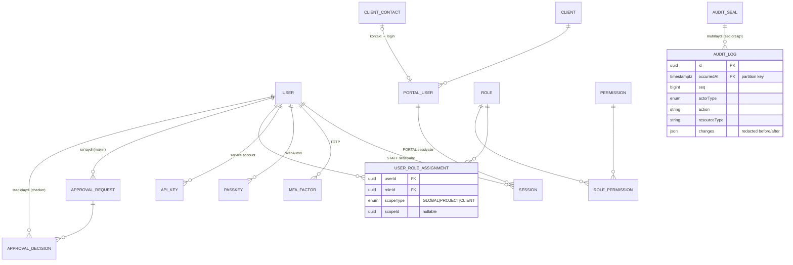
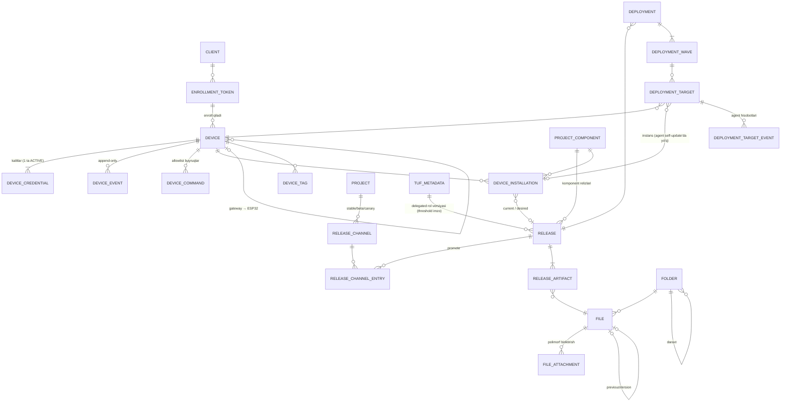
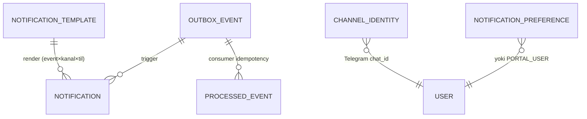
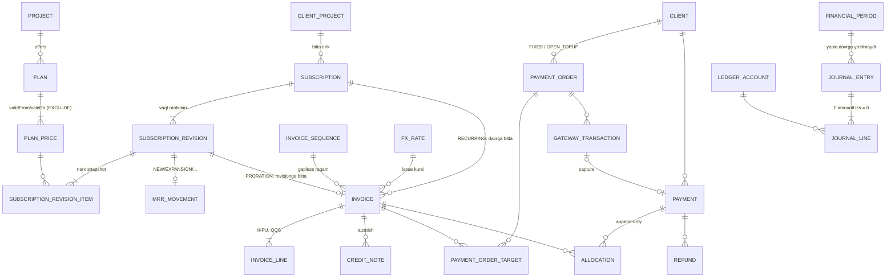

# ER diagrammalar

> ADS-ERP arxitektura hujjatlari · tasdiqlangan reja (2026-11-10) asosida · [Hujjatlar indeksi](../../README.md)

## 5. Ma'lumotlar bazasi: ER diagrammalar

### 5.1 Umumiy (aggregate darajasida) ER

```mermaid
erDiagram
  CLIENT ||--o{ CLIENT_CONTACT : has
  CLIENT ||--o{ CLIENT_SITE : has
  CLIENT ||--o{ PORTAL_USER : "login'lari"
  CLIENT ||--o{ CLIENT_PROJECT : uses
  PROJECT ||--o{ CLIENT_PROJECT : serves
  PROJECT ||--o{ PROJECT_MEMBER : team
  PROJECT ||--|{ PROJECT_COMPONENT : "qismlar (VPS, GPU, ESP32 …)"
  PROJECT ||--o{ PLAN : offers
  PLAN ||--|{ PLAN_PRICE : "narx tarixi"
  CLIENT_PROJECT ||--o{ SUBSCRIPTION : "bitta tirik"
  SUBSCRIPTION ||--|{ SUBSCRIPTION_REVISION : "shartlar tarixi"
  PLAN_PRICE ||--o{ SUBSCRIPTION_REVISION : "narx snapshot (item)"
  SUBSCRIPTION ||--o{ INVOICE : generates
  CLIENT ||--o{ INVOICE : "billed to"
  INVOICE ||--|{ INVOICE_LINE : contains
  CLIENT ||--o{ PAYMENT : pays
  PAYMENT ||--o{ ALLOCATION : splits
  INVOICE ||--o{ ALLOCATION : "settled by"
  GATEWAY_TRANSACTION |o--o| PAYMENT : produces
  CLIENT ||--o{ JOURNAL_LINE : "akt-sverka (clientId)"
  CLIENT |o--o{ DEVICE : "egasi (COMPANY qurilmada yo'q)"
  CLIENT_SITE ||--o{ DEVICE : hosts
  DEVICE |o--o{ DEVICE : "gateway (ESP32)"
  DEVICE ||--o{ DEVICE_INSTALLATION : "instanslar"
  PROJECT_COMPONENT ||--o{ DEVICE_INSTALLATION : "o'rnatilgan"
  CLIENT_PROJECT |o--o{ DEVICE_INSTALLATION : "entitles (shared'da yo'q)"
  PROJECT_COMPONENT ||--o{ RELEASE : versions
  RELEASE ||--|{ RELEASE_ARTIFACT : "platforma bo'yicha"
  FILE ||--o| RELEASE_ARTIFACT : stores
  RELEASE ||--o{ DEPLOYMENT : "rolled out by"
  DEPLOYMENT ||--|{ DEPLOYMENT_WAVE : phases
  DEPLOYMENT ||--o{ DEPLOYMENT_TARGET : targets
  DEVICE ||--o{ DEPLOYMENT_TARGET : receives
  USER ||--o{ USER_ROLE_ASSIGNMENT : has
  ROLE ||--o{ USER_ROLE_ASSIGNMENT : "assigned (scope)"
  ROLE ||--o{ ROLE_PERMISSION : grants
  PERMISSION ||--o{ ROLE_PERMISSION : "granted in"
```

**Asosiy g'oya:** M:N munosabat `CLIENT_PROJECT` — o'z atributlari bor **birinchi darajali entity** (status, menejer, default kanal). Obunalar, qurilmadagi o'rnatmalar va entitlement aynan shu bog'lanishga osiladi — shuning uchun "bu mijoz bu loyihani ishlatadimi va to'laganmi?" savoliga bitta joydan javob olinadi.

### 5.2 IAM, Approvals, Audit

### 5.3 Devices, Releases, Deployments, Files

### 5.4 Notifications va System

Billing/Finance ER — quyida 5.5 da.

### 5.5 Billing/Finance ER (7.3 bo'limidan)

