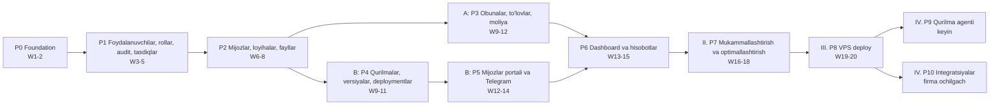

# Development roadmap

> ADS-ERP arxitektura hujjatlari · v3 (2026-11-10) · [Hujjatlar indeksi](README.md)

> **Holat (2026-11-11):** I bosqich — sayt (**P0–P6**) bajarildi va tekshirildi (demo ma'lumotlar, smoke test `npm test`). Amalga oshirishdagi aniqlashtirishlar: [ADR-0019](adr/ADR-0019-v1-implementation-stack.md). Keyingi: **P7** (testlar, mukammallashtirish, optimallashtirish).

## Tamoyil: avval sayt — ishlaydigan menejment tizimi
- ADS-ERP — **faqat menejment tizimi**. Loyihalarning kodi (AI, avtomatizatsiya, firmware …) undan **mustaqil** ishlab chiqiladi va ishga tushiriladi.
- Tartib: **I. Sayt (lokal, ishlaydigan tizim) → II. Mukammallashtirish va optimallashtirish → III. VPS deploy → IV. Qurilma agenti va integratsiyalar.**
- Birinchi versiyada qurilmalar, versiyalar va deploymentlar saytda **reyestr va qo'lda kuzatuv** sifatida yuritiladi (qaysi mijozda, qaysi qurilmada, qaysi versiya ishlayapti). Avtomatik yetkazish (agent) — IV bosqichda, avval soddalashtirilgan ko'rinishda: **imzolangan faylni qurilmaga yuborish va ishga tushirish**.

Taxmin: **3 full-stack dasturchi**; Go/agent dasturchi faqat IV bosqichda kerak. P2'dan keyin ikki parallel trek.

| Bosqich | Haftalar | Asosiy natijalar |
|---|---|---|
| **I. Sayt — ishlaydigan menejment tizimi (lokal)** | | |
| **P0 Foundation** | 1–2 | Monorepo, lokal docker compose (PostgreSQL, Redis, MinIO), CI, `packages/db` (tekshirilgan schema + `integrity.sql` + **115 ta integrity testi** → Vitest/Testcontainers), NestJS (`api` + `worker`), admin SPA shell + dizayn tizimi, i18n (uz/ru/en), demo ma'lumot generatori |
| **P1 Foydalanuvchilar · Rollar · Audit · Tasdiqlar · Bildirishnomalar** | 3–5 | Xodimlar auth (parol + TOTP), rollar (Rahbar, Menejer, Buxgalter, …), **rahbar menejerga ruxsat beradi** (doimiy yoki muddatli), tasdiqlash siyosatlari (ruxsat bo'yicha), audit + seal, in-app + Telegram bildirishnomalar |
| **P2 Mijozlar · Loyihalar · Fayllar** | 6–8 | Mijozlar (kontakt, filial, teg, eslatma), loyihalar + komponentlar, mijoz ↔ loyiha (M:N), fayllar (yuklash, SHA-256, antivirus, versiya), global qidiruv |
| **A: P3 Obunalar · To'lovlar · Moliya** | 9–12 | Tariflar (QQS 0), obunalar + tarix, oylik invoice'lar (idempotent), invoice PDF, **qo'lda to'lov + rahbar tasdig'i**, kredit, refund, credit note, ledger + akt-sverka, CBU kurslari, **oy oxiri USD qayta baholash va oy yopilishi**, qarzdorlik eslatmalari — **M1: moliya ishlaydi** |
| **B: P4 Qurilmalar · Versiyalar · Deploymentlar (reyestr)** | 9–11 | Qurilmalar reyestri (VPS — kompaniyaniki, server, GPU, Raspberry Pi, ESP32, desktop; mijoz/filial), versiyalar (loyiha/komponent bo'yicha, fayllar, release notes), **deployment yozuvlari**: reja → tasdiq (rahbar yoki ruxsat berilgan menejer) → qurilma/instans bo'yicha natija qo'lda belgilanadi → "qayerda qaysi versiya" ko'rinishi — **M2: to'liq menejment manzarasi** |
| **B: P5 Mijozlar portali · Telegram** | 12–14 | Portal (auth, RLS, obunalar, invoicelar, akt-sverka, o'z qurilmalari va versiyalari), bank o'tkazmasi rekvizitlari, mijozlar uchun Telegram — **M3** |
| **P6 Dashboard · Analytics · Hisobotlar** | 13–15 | MRR/ARR/churn, qarzdorlik aging, to'lovlar, versiyalar taqsimoti, rolga mos dashboardlar, eksport |
| **II. P7 Mukammallashtirish va optimallashtirish** | 16–18 | Performance tuning, xavfsizlik review, UX sayqal, load/chaos testlar, runbook'lar, lokal backup/restore mashqlari |
| **III. P8 VPS deploy** | 19–20 | Hosting tanlovi (O'zbekiston, PD lokalizatsiyasi), production compose + TLS, PITR backup, monitoring, staging — **M4: production** |
| **IV. P9 Qurilma agenti** | keyin | Go agent (Linux/Windows; kompaniya VPS'i va mijoz qurilmalari): **imzolangan faylni yuborish va ishga tushirish**, natijani saytga qaytarish; keyin bosqichli rollout va self-update. ESP32, Docker, AI modellar — ehtiyojga qarab ([04-update-agent.md](architecture/04-update-agent.md) — maqsadli dizayn) |
| **IV. P10 Integratsiyalar** | firma ochilgach | ✅ Payme, Click, Uzum, Paynet — haqiqiy protokol + emulyator, kabinetda oylik/yillik obunani sotib olish, kartalar, avtomatik to'lov ([ADR-0021](adr/ADR-0021-online-payments-gateways.md)). Qolgan: sandbox sertifikatsiyasi (merchant kalitlari + ommaviy URL), rekonsiliatsiya, fiskal chek (IKPU), QQS, e-faktura, 1C eksport, SMS |

**Milestone'lar:** M1 (W12) moliya ishlaydi → M2 (W11) qurilma/versiya/deployment reyestri → M3 (W14) mijozlar portali → **M4 (≈W20) VPS'da production** → IV bosqich (agent, integratsiyalar).
